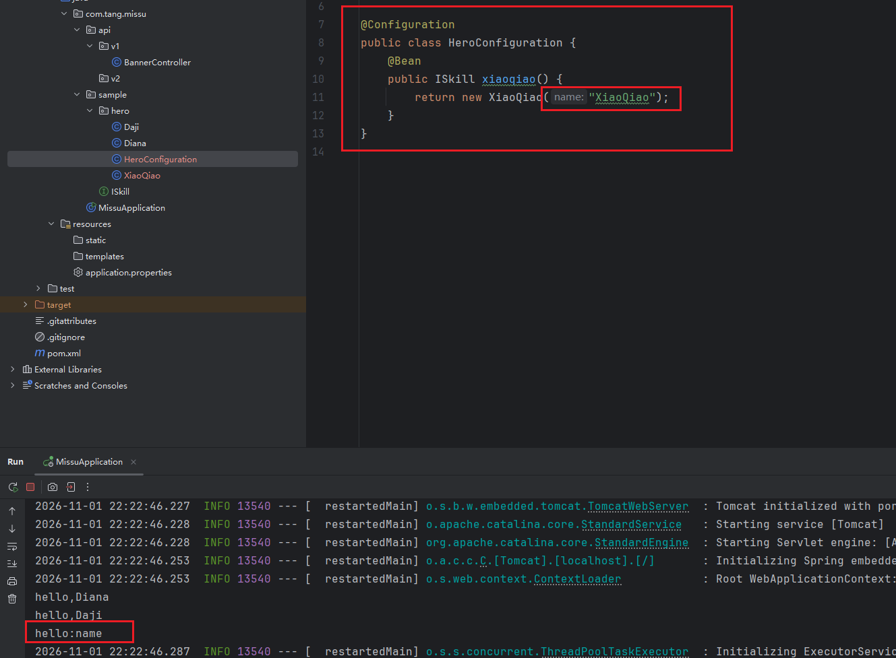
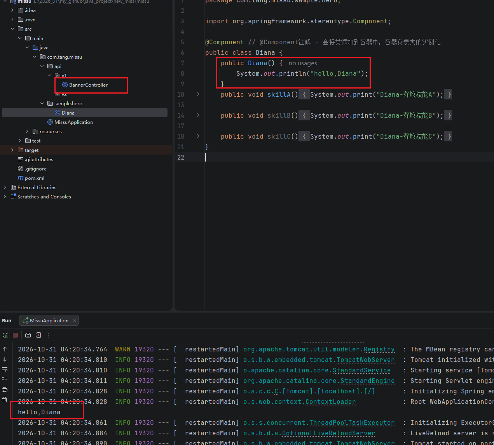
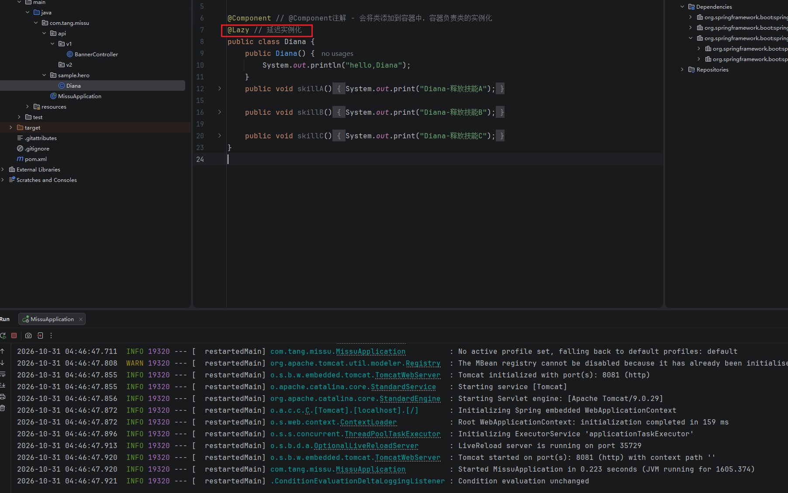

# SpringBoot 理论

## Spring，SpringMVC，SpringBoot的关系与区别

## SpringBoot中的IOC
- IOC实现： 容器；加入容器（将对象加入到容器中）；注入(将容器中的对象注入到代码中)

### 加入容器的方式
1. XML - 现在用的少
2. 注解
之前不用注解时候的代码：
```java

```

### 模式注解 - stereotype annotations
- 分为3类

1. @Component - （最基础的模式注解，类的实例化）加入到容器中，会负责类的实例化
- @Autowired - 注入对象到代码中
示例：
```java
@Component // 将类添加到容器中，由容器进行实例化
public class Diana {
    public void skillA() { System.out.print("Diana-释放技能A"); }
    public void skillB() { System.out.print("Diana-释放技能B"); }
    public void skillC() { System.out.print("Diana-释放技能C"); }
}

@Component
public class DianaUser {          // 新建一个类来使用 Diana
    @Autowired // 注入到代码中
    private Diana diana;          

    public void use() {         
        diana.skillA(); // 这里可以使用diana这个对象了
    }
}
```

2. @Service（服务）；@Controller（控制器）；@Repository（仓储）；
- 都是以 @Component 为基础的，如果没有意义的类推荐用@Component，有意义的就用以上

- 为何SpringBoot中的BannerController没有在main中new可以通过接口直接访问？
因为是间接的IOC
BannerController使用了@RestController注解，@@RestControlle中包含@Controller，而@Controller包含@Component（所以说@Controller是以@Component为基础的）

3. @Configuration
- 可以自己new 一个类带参（之前的@Compoent都是容器new的，无法带参）
- 为了代替以前的xml方式，以前xml方式注入的时候：
- 主要作用：读取配置文件；将bean加入到IOC容器中

将类XiaoQiao加入了容器且可以给类传参；应用：连接数据库的配置，读取配置文件


### IOC 对象 实例化，注入 时机的问题
1. 注入时机问题
`IOC容器是在什么时候实例化对象并且将对象注入带代码片段中的？`
有两种情况
1) 访问Controller的时候 - 延迟实例化使用注解@Lazy，一般没有特殊需求不要开始延迟的实例化
（注意C延迟了，但是A调用了C没延迟，还是未达到延迟的效果）

2) springBoot应用启动的时候（默认是应用启动的时候）
示例：

并未访问BannerController接口，但是SpringBoot已启动就打印了Diana中的内容（即实例化了Diana对象并注入到代码中）


此时，启动应用并未打印打印Diana中的内容，只有在访问Controller的时候才会实例化打印

2. 注入方式问题（都要加上**@Autowired**）
一般是 **属性注入** 和 **构造函数注入** 以及**setter注入**，更推荐**构造函数注入**
```java
public class BannerController {

    /* @Autowired注解 - 注入对象，属性注入 */
    @Autowired
    private Diana diana;
}
```
```java
//注入对象 -  构造函数注入
private Diana diana;

@Autowired
public BannerController(Diana diana) {
    this.diana = diana;
}
```
setter注入,快速生成一个setter，选中Diana对象右键generate生成一个setter
```java
/*注入-setter方式注入*/
    private Diana diana;
    @Autowired
    public void setDiana(Diana diana) {
        this.diana = diana;
    }
```

## @Autowired 注入方式
有两种注入方式，bytype（按类型注入，默认的注入方式）；byname（按名字注入）

1) 只有一个类实现接口的情况 - 按照类型注入
例如Diana这个类实现了ISkill接口，则 即使变量名写的是daji，也是注入的dian这个对象。
Autowired会按照类型找到实现ISkill的类
```java
private ISkill daji;
public String test() {
        daji.skillA(); 
        return  "hi,hanber，你好，十一月";
    }
```
2) 有多个类实现接口 - 按照名字注入
例如 Diana和Daji都实现了接口ISkill，则按照变量名注入才知道注入是哪个，如果不写的是不存在的类名，会报错
```java
private ISkill iSkill; // 会报错，此时只能是diana和daji
public String test() {
        daji.skillA(); 
        return  "hi,hanber，你好，十一月";
    }
```

### 修改指定注入 - @Qualifier
默认是 bytype 注入，且多个是buname注入，都是springboot自己推断的，如果要手动指定注入的bean，则用**@Qualifier**
如:
```java
    @Autowired
    @Qualifier("diana")
    private ISkill daji; // 即使字段名是daji，但是注入的是Diana
```