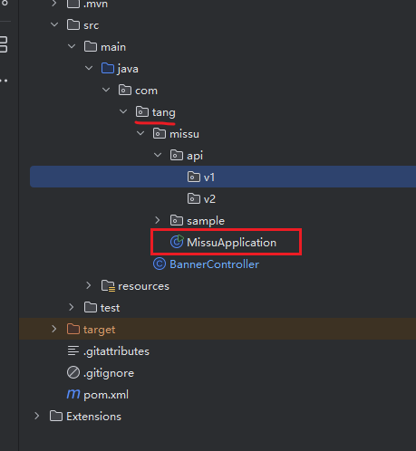
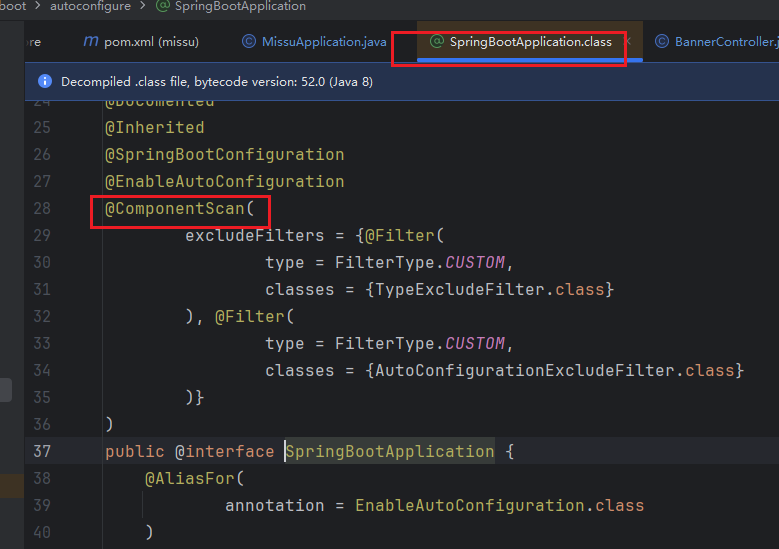
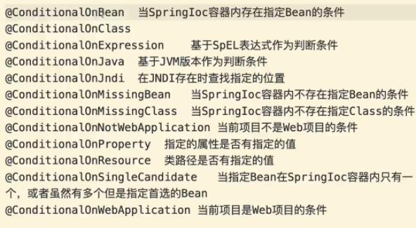

# @ComponentScan - 指定扫描包
- 指定扫描带有@Component注解的包
`SpringBoot默认只能扫描到当前启动类的同级或子集的相关包`
如：将BannerController类移动到上一级就扫描不到。


`启动类的注解@SpringBootApplication中包含 @ComponentScan`


## 手动指定扫描包
`默认扫描com.tang.missu下的包，如果将如：将BannerController类移动到上一级需要手动指定扫描包。`
应用场景：很多复用组件jar包，需要扫描才能加入到IOC容器中
[@ComponentScan](assets/sp_zj/componentScan_3.png)


# @Primary - 优先注入
`之前有多了类注入，只写private ISkill iSkill;会报错，加了@Primary注解会注入加了该注解的类` 


# 条件注解 - @Contional 按条件加入IOC容器
`只有满足条件的时候，bean才会加入到容器中，不满足条件不会加入`
1. 不要弄混@Qualifier， 修改指定注入 - @Qualifier
2. 不仅是配置类可以用条件注解，@Component也可以用

## 自定义条件注解
`需要 Condition类 + @Conditional注解实现`
如：XiaoQiao类需要按照条件加入到IOC容器中
1) 实现XiaoQiaoContion 条件类
```java
/* 条件类，需要实现Condition接口，springboot内置的 */
// 选择Springframework的
public class XiaoQiaoCondition implements Condition {
    // 需要实现接口必须实现它的方法，右键implements -> Select Methods to implements
    @Override
    public boolean matches(ConditionContext conditionContext, AnnotatedTypeMetadata annotatedTypeMetadata) {
        // 这里返回true则会加入到IOC容器（可动态根据条件加入）
        return false;
    }
}
```

2) 将条件类加入到@Conditional注解中
```java
/* 配置类 */
@Configuration
public class HeroConfiguration {
    @Bean
    @Conditional(XiaoQiaoCondition.class) //将条件类传入到Conditional注解中
    public ISkill xiaoqiao() {
        return new XiaoQiao("XiaoQiao");
    }
}
```

`获取配置文件中的条件，根据条件返回是否将bean加入到容器中`
```java
/* 条件类，需要实现Condition接口，springboot内置的 */
// 选择Springframework的
public class YaseCondition implements Condition {
    // 需要实现接口必须实现它的方法，右键implements -> Select Methods to implements
    @Override
    public boolean matches(ConditionContext conditionContext, AnnotatedTypeMetadata annotatedTypeMetadata) {
        // 获取配置文件中的hero.name 根据名字将类加入到IOC容器中
        String name = conditionContext.getEnvironment().getProperty("hero.name");
        // 这里返回true则会加入到IOC容器（可动态根据条件加入）
        //return true;
        return "yase".equalsIgnoreCase(name);
    }
}
```


# @ConditionalOnProperty - 成品条件注解(用的最多)
```java
    @Bean
    @ConditionalOnProperty(value = "hero.condition",havingValue = "anqila",matchIfMissing = true) // 不用再写条件类,matchIfMissing默认是false，如果找不到会报错，否则会给默认值Anqila类
    public ISkill anqila(){
        return new Anqila("安琪拉");
    }
```

## 其他成品条件注解


## @ConditionalOnBean - 当IOC容器存在指定的Bean条件
```java
@ConditionalOnBean(name="diana") // 存在diana这个bean才执行
```
`反之有条件注解@ConditionalMissingBean 不存在指定的Bean的条件`


# SpringBoot的自动装配
## 1.原理是什么？
启动类中的@SpringBootApplication中包含 @EnableAutoConfiguration，@EnableAutoConfiguration的主要作用的自动装配第三方的sdk，如maven装的依赖和jar包中bean
即：将第三方bean加入到项目中的IOC容器中

### @Enablexxx - 模块装配
- @Import(xxxSelector.class) + 实现 Import的Selector类
1. LOLConfigurationSelector
```java
/* seletor类需要实现 ImportSelector */
public class LOLConfigurationSelector implements ImportSelector {

    @Override
    public String[] selectImports(AnnotationMetadata annotationMetadata) {
        return new String[]{HeroConfiguration.class.getName()};
    }
} 
```

2. @EnableLOLConfiguration
```java
@Retention(RetentionPolicy.RUNTIME)
@Target(ElementType.TYPE)
@Documented
@Import(HeroConfiguration.class)
public @interface EnableLOLConfiguration {
}
```

3. LOL启动类
```java
@EnableLOLConfiguration
public class LOLApplication {
    public static void main(String[] args) {
        ConfigurableApplicationContext context = new SpringApplicationBuilder(LOLApplication.class)
                .web(WebApplicationType.NONE) // 将web服务关掉
                .run(args);
        ISkill iSkill = (ISkill) context.getBean("anqila");
        iSkill.skillA();
    }
}
```


## 2.为什么要有自动装配？
最核心的是：如何发现配置的bean将它们加入到IOC容器里


# Java SPI机制
