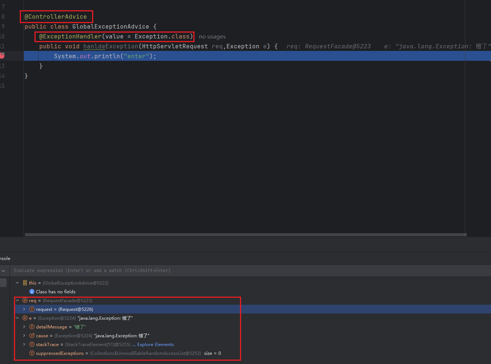
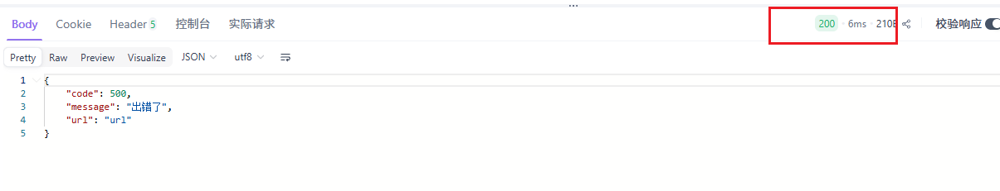
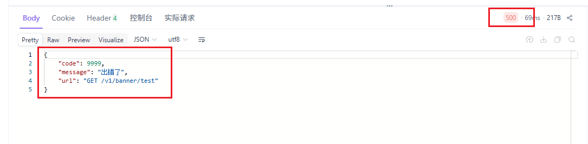
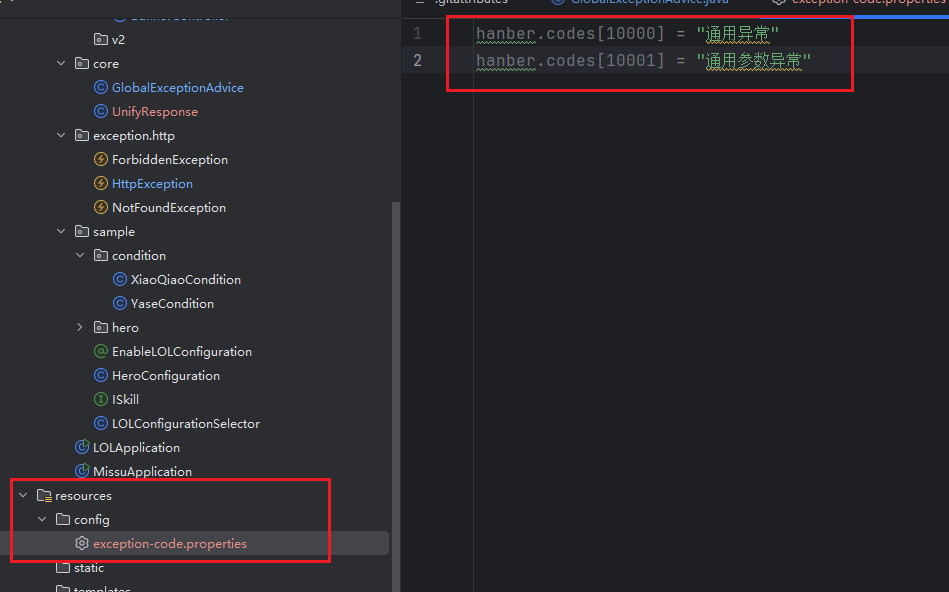
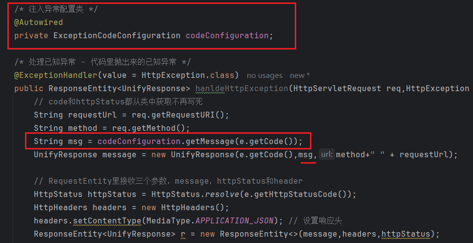
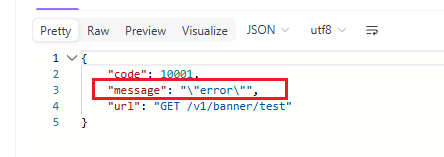

# 如何统一捕获异常
1. @ControllerAdvice 标注异常处理类
`它的主要作用是“辅助”控制器，允许你在一个地方定义的方法，全局性地应用到多个（甚至所有）@Controller 上。默认情况下，如果不做任何配置，它的作用范围是所有的控制器。`
应用核心场景：全局异常处理（最常用）

2. @ExceptionHandler 异常处理器



# 异常分类
首先需要区分错误和异常
- Error 错误，是代码无法处理的，程序无法启动或jvm虚拟机引起的
- Exception 异常，可以通过代码处理的才叫异常

## Exception 又分为两种异常
- CheckedExcption 可以被检测到的异常（这种异常必须要强制处理的，函数抛出异常也算是处理了异常不是只return异常）
可以处理的适用（比如文件路径不正确）
- RuntimeException 运行时异常
无法处理的适用（如用户输入不存在的订单id）

## 已知异常和未知异常
- 已知异常-程序员处理了的异常
如 分母 为0时候，判断了并抛出了异常
- 未知异常 - 未经过思考的异常
如 分母 为0时候，没有判断但是系统抛出了


# 自定义 HttpException
- HttpException 是代表 http类型的异常
- HttpException 需要继承 RuntimeException or Exception
- 具体的异常类需要继承HttpException（NotFoundException，ForbiddenException）
1. HttpException
```java
/* 要继承异常类 RuntimeException-运行时异常 */
public class HttpException extends RuntimeException {
    protected Integer code;
    protected Integer httpStatusCode = 500;
}
```
2. 具体的异常子类
```java
public class NotFoundException extends HttpException{
    public NotFoundException(int code) {
        this.code = code;
        this.httpStatusCode = 401;
    }
}
```
3. 添加到统一捕获中
```java
@ControllerAdvice
public class GlobalExceptionAdvice {
    @ExceptionHandler(value = HttpException.class)
    public void hanldeHttpException(HttpServletRequest req,HttpException e) {
        System.out.println("enter");
    }
}
```
4. 抛出异常
```java
throw new NotFoundException(4001);
```


## 同时监听Exception和HttpException
- 如果统一捕获中Exception和HttpException异常，NotFoundException会执行哪一个 ?
- 只进入了HttpException未进入Exception（两个断点，按F9继续执行）
```java
@ControllerAdvice
public class GlobalExceptionAdvice {
    @ExceptionHandler(value = Exception.class)
    public void hanldeException(HttpServletRequest req,Exception e) {
        System.out.println("enter1");
    }

    @ExceptionHandler(value = HttpException.class)
    public void hanldeHttpException(HttpServletRequest req,HttpException e) {
        System.out.println("enter2");
    }
}
```

## 将异常处理为UnifyResponse格式
- 将异常处理为UnifyResponse格式返回给前端
```json
{
  code:10001
  message:xxx
  request:GET url
}
```
1. 定义一个UnifyResponse类
```java
public class UnifyResponse {
    private int code;
    private String message;
    private String url;

    /* 因为上面的成员变量都是private的，外部无法读取，需要getter */
    public int getCode() {
        return code;
    }

    public String getMessage() {
        return message;
    }

    public String getUrl() {
        return url;
    }

    public UnifyResponse(int code, String message, String url) {
        this.code = code;
        this.message = message;
        this.url = url;
    }
}
```

2. 异常返回UnifyResponse类型数据
```java
@ExceptionHandler(value = Exception.class)
@ResponseBody
public UnifyResponse hanldeException(HttpServletRequest req,Exception e) {
    UnifyResponse message = new UnifyResponse(9999,"出错了","url");
    return message;
}
```


## 处理未知异常
### 修改http状态码
- 虽然上面代码抛出了异常，但是http状态码仍然是200


`@ResponseStatus注解修改http状态`
```java
@ResponseStatus(code = HttpStatus.INTERNAL_SERVER_ERROR) // 500
```

`获取请求接口名和类型`
```java
/* 处理未知异常  */
    @ExceptionHandler(value = Exception.class)
    @ResponseBody
    @ResponseStatus(code = HttpStatus.INTERNAL_SERVER_ERROR) // 500
    public UnifyResponse hanldeException(HttpServletRequest req,Exception e) {
        String requestUrl = req.getRequestURI(); // 获取请求接口名
        String method = req.getMethod(); // 获取请求类型
        UnifyResponse message = new UnifyResponse(9999,"出错了",method + " " +requestUrl);
        return message;
    }
```



## 处理已知异常
- 不用@ResponseBody用 ResponseEntity包裹，之前的@ResponseBody会自动处理

```java
/* 处理已知异常 - 代码里抛出来的已知异常 */
@ExceptionHandler(value = HttpException.class)
public ResponseEntity<UnifyResponse> hanldeHttpException(HttpServletRequest req,HttpException e) {
    // code和httpStatus都从类中获取不再写死
    String requestUrl = req.getRequestURI();
    String method = req.getMethod();
    UnifyResponse message = new UnifyResponse(e.getCode(),"xxx",method+" " + requestUrl);

    // RequestEntity里接收三个参数，message，httpStatus和header
    HttpStatus httpStatus = HttpStatus.resolve(e.getHttpStatusCode());
    HttpHeaders headers = new HttpHeaders();
    headers.setContentType(MediaType.APPLICATION_JSON); // 设置响应头
    ResponseEntity<UnifyResponse> r = new ResponseEntity<>(message,headers,httpStatus);
    return r;
}
```

## 将message消息写进配置文件
- 避免将文本信息硬编码，散落在代码中
- 便于统一管理以及日后做国际化

1. 写code和message对应的配置文件
- 写在resources下


2. 写code的配置类
- 根据code获取message，map结构

3. 将配置类和配置文件关联
- @PropertySource 将类和配置文件关联
- @ConfigurationProperties 指定前缀
```java
//将配置类和配置文件关联
//将配置类和配置文件关联
@PropertySource(value = "classpath:config/exception-code.properties") // 将类和配置文件关联
@ConfigurationProperties("hanber") // 指定前缀，因为关联只能关联codes，需要指定前缀hanber.codes
@Component
public class ExceptionCodeConfiguration {
    private Map<Integer,String> codes = new HashMap<>();

    public Map<Integer, String> getCodes() {
        return codes;
    }

    public void setCodes(Map<Integer, String> codes) {
        this.codes = codes;
    }

    // 根据传入code返回message
    public String getMessage(int code){
        // map中code对应的message
        String message= codes.get(code);
        return message;
    }
}
```

4. 将配置类注入到统一处理异常的地方


`但此时中文乱码`

- 配置文件是没有""引号的


# 根据目录结构生成api前缀
- 每次都要手写 /v1/模块名很麻烦，如果目录层级深更长，之前是使用@RequestMapping("前缀")
- 要继承 RequestMappingHandleMapping
- 覆盖 getMappingForMethod 方法，先接收RequestMappingInfo，再修改路由信息  
 


