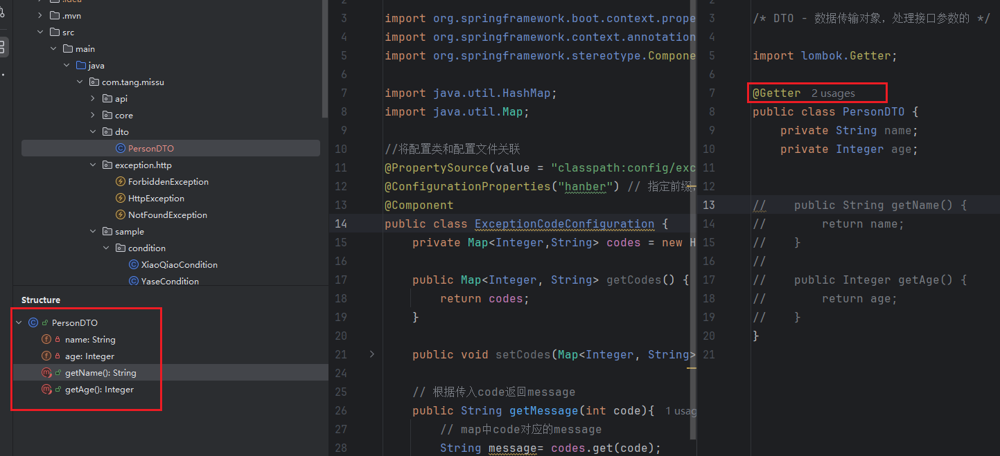
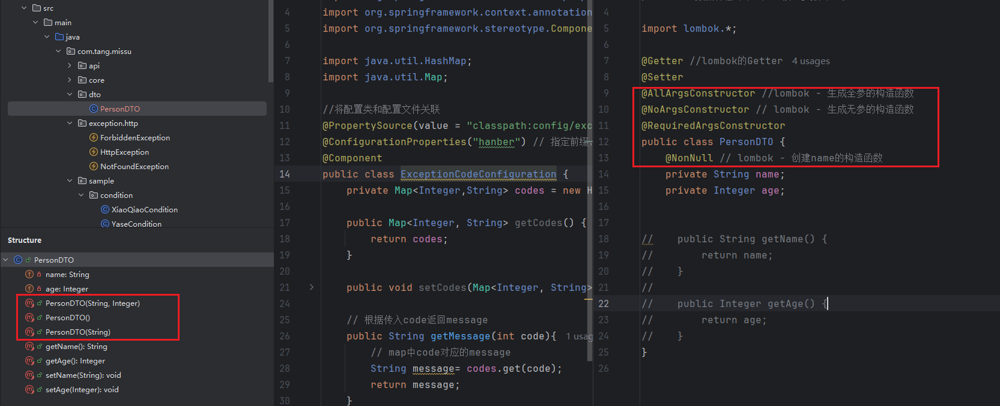

# 参数校验
- 代码不能写在控制器中，控制器中不能写业务逻辑

# 1. 参数处理分两类
## 1. 通过url传递的 - query
### 1.1 写在路径中的，如/id/123
`如何接收参数？`
- 注解 @PathVariable接收
```java
@GetMapping("/test/params/{id}")
public String testParams(@PathVariable  Integer id){
    return "hi,hanber" + id;
}

// 可以指定参数名
@GetMapping("/test/params/{id1}")
public String testParams(@PathVariable(name = "id1")  Integer id){
    return "hi,hanber" + id;
}

/* 接收参数
* @PathVariable - 接收路径中的
* @RequestParam - 接收 ? 后的 query 参数
* */
@GetMapping("/test/params/{id1}")
public String testParams(@PathVariable(name = "id1")  Integer id,@RequestParam String name){
    return "hi,hanber" + id + name;
}
```

### 1.2 写在 ? 后的，如 ?id = 123
`如何接收参数？`
- @RequestParam - 接收 ? 后的 query 参数
```java
/* 接收参数
* @PathVariable - 接收路径中的
* @RequestParam - 接收 ? 后的 query 参数
* */
@GetMapping("/test/params/{id1}")
public String testParams(@PathVariable(name = "id1")  Integer id,@RequestParam String name){
    return "hi,hanber" + id + name;
}
```

## 2. 通过post请求传递的 - request body
- 既可以在url中传递参数，也可以在body中传递参数
- 注解@RequestBody接收参数，但是指定接收参数的类型


数据传输对象
- DTO 就是专门用来“搬数据”的简单对象，目的是解耦、裁剪字段、保证安全和适配接口契约。
```java
// PersonDTO
/* DTO - 数据传输对象，处理接口参数的 */
public class PersonDTO {
    private String name;
    private Integer age;


    public String getName() {
        return name;
    }

    public Integer getAge() {
        return age;
    }
}

// @RequestBody接收参数
@PostMapping("/test/post")
public String testPost(@RequestBody PersonDTO person){
    return "hi" + "name:" + person.getName() + " age:" + person.getAge();
}
```


# 2. Lombok
- Lombok 是一个 Java 库，它通过注解在编译期自动生成样板代码，让你不用手写 getter、setter、构造方法
- 类中的getter，setter会使得里面的模板代码非常多，打上@Getter@Setter,Lombok会自动生成对应的

## maven安装Lombok
- 版本号可以不写，或者指定某个版本
```xml
<dependency>
  <groupId>org.projectlombok</groupId>
  <artifactId>lombok</artifactId>
</dependency>
```

## @Getter和@Setter
- 会给bean生成getter和setter方法，但对final无效
- 不用再写getAge，setAge


### 与@Data注解的不同
- 除了有getter和setter方法，还会生成equals，hashCode，toString方法


## Lombok创建构造函数
1. @AllArgsConstructor - 创建全参数的构造函数
- 自动生成有参的构造函数

2. @NoArgsConstructor - 创建无参的构造函数

3. @RequiredArgusConstructor + @NonNull - 创建非空参数的构造函数


## @Builder - 可以直接给成员变量赋值
- 不用每个成员变量都写setter赋值
- 问题1：打上 @Builder之后就不能通过new的方法实例化对象，会报错。会默认使用builder的方法实例化对象
因为 @Builder 会生成私有的构造函数，不支持外部访问
解决办法：打上@NoArgsConstructor生成public的无参构造函数
- 问题2：用builder实例化的对象返回前端需要加@Getter

```java
PersonDTO dto = PersonDTO.builder()
                 .name("ber")
                 .age(3)
                 .build();
```


# 3. 参数校验
- 验证的代码不要写在控制器中

## 1.使用基础注解进行参数校验
- @Validate +  @Max，@Min，@Range，@Positive