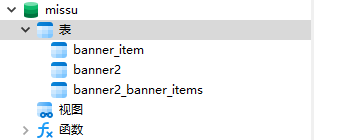

api - 是请求第一层
service - 是业务逻辑第二层
repository - 操作数据库（仓储层），第三层
层与层之间通过接口衔接

# 项目分层设计和JPA
## JPA 和 MyBatis
- 本质上是一套 ORM 规范，而非具体实现，都是简化数据库操作
- JPA 是“以对象为中心”的全自动 ORM 规范，而 MyBatis 是“以 SQL 为中心”的半自动映射框
- MyBatis 是什么：掌控 SQL 的半自动映射框架


# Service 层 - 写业务逻辑
- 使用@Service注解


## 层与层之间是否一定要用接口建立关联
- 比如Controller中调用Service层
- 简单的不用，复杂的经常修改的需要按照规范通过接口建立关联


# 创建数据库表的3种主要方式
- 首先安装mysql，mysql.com

1. 可视化管理工具（navicat） utf8m64,utf8m64_general_ci
2. SQL语句生成数据库表
3. Model 模型类映射

##  写数据库配置文件
- 都是用的Properties文件，Spring Boot是支持YML文件的，这里使用YML文件进行配置。好处是yml中可以用：分模块，不用一直点,就可以将项目中的Properties文件删除
- 优先使用YML有更好的层级结构。

1)  yml文件
- 注意冒号后面需要有空格
```yml
server:
  port: 8081

mysql:
  ip: 127.0.0.1
  port: 3306
```
`Properties文件格式`
```properties
server.port = 8081
hero.name = yase
hero.condition = anqila
```


## 多环境配置文件 - 分开发生产环境
1. config中创建 appliaction-dev.yml 和 application-prod.yml （如果有需要可以创建application-test.yml等）
2. appliaction.yml 在任何环境下都会生效，appliaction-dev.yml在DEV环境下生效，application-prod.yml在生产环境下生效
3. 激活指定环境
- 在appliaction.yml中指定
```yml
# 激活指定环境
spring:
  profiles:
    active: prod
```

- 开发环境是通过IDE启动项目的，生产环境没有IDE通过命令启动
> maven中 -> Run Maven Build 或者 maven命令行中输入 mvn clean package
target目录下生成打包好的jar包 - uber jar 超级jar包，不用tomcat服务器就可以启动，老的war包需要配合tomcat服务器才能启动
```cmd
// 启动命令并指定环境
java -jar xxx.jar --spring.profiles.active=dev
```


## 数据库配置
```yml
spring:
  datasource:
    url: jdbc:mysql://localhost:3306/missu?characterEncoding=utf-8&serverTimezone=GMT%2B8
    username: root
    password: 123456
```


## Model 模型类映射
- ORM方式，主要是如何处理实体与实体之间的关系配置

### 1. 写模型类 model/Banner
```java
public class Banner {
    private long id;
    private String name;
    private String decscription;
    private String img;
    private String title;
}
```

### 将Banner的模型映射到数据库中
- Banner模型上打上注解 @Entity，表明是一个实体
- @Entity(实体)不是springboot自带的，是持久化库，需要安装jpa依赖.(alt+enter 快速导入)
- 安转依赖：mysql连接器和jdbc
- jpa的配置

> 启动程序 missu下会多一张banner的表

```java
@Entity
@Table(name = "banner2") // 数据库中表明重命名 banner1
public class Banner {
    @Id // 给Entity打标识（主键），javax.persistence的
    @GeneratedValue(strategy = GenerationType.IDENTITY) // id自增长
    private long id;

    @Column(length = 16) // 限制表中name长度16
    private String name;

    @Transient // 表明字段不会映射到表中
    private String description;
    private String img;
    private String title;
}
```

`安装jpa依赖:`
```xml
<dependency>
    <groupId>org.springframework.boot</groupId>
    <artifactId>spring-boot-starter-data-jpa</artifactId>
</dependency>
```

`jpa配置:`
```yml
spring:
  profiles:
    active: dev
  jpa:
    hibernate:
      ddl-auto: update 
```

`安装ysql连接器和jdbc依赖:`
```xml
<dependency>
    <groupId>org.springframework.boot</groupId>
    <artifactId>spring-boot-starter-jdbc</artifactId>
</dependency>
<dependency>
    <groupId>mysql</groupId>
    <artifactId>mysql-connector-java</artifactId>
    <scope>runtime </scope>
</dependency>
```


## maven依赖安转失败原因自查
- 安装成功是在mavnen的依赖中可以看到，而不是有红色提示

1) 网络环境问题，更换数据源
2) 如何既没有红线又无代码报错，可能是缓存原因未实时更新 ---重启IDE
3) 检查是否关闭mavne的离线模式，离线会优先找本地的依赖（ctrl + alt + s）


# 数据库 表与表之间的关系
1. 1对1
> 人 - 身份证 （一个人只能有一张身份证）
2. 1对多 （最简单）
> 游戏 - 英雄（一款游戏中有多个英雄） ;班级-学生（一个班级有多个学生）
3. 多对多（复杂）
- 老师 - 学生，一个老师可以教多个学生，一个学生也可以有多个老师

## 1对1
1. 查询效率上，避免1个表上太多字段
2. 业务的角度

## 多对多
- 两张表无法表示 多对多 的关系，通常有中间表，**3张表才能表示多对多的关系**
> teacher表和student表，需要中间表 teacher_student,字段 id teacher_id,student_id
- 第三张表无意义（只有两种表的关系字段，3个字段），也可有意义（有本身的业务意义）


# 数据库的设计步骤
- 将数据库中的表当做模型或面向对象进行思考

1. 找业务对象，一个业务对象一张表
如：Coupon，Order，Banner，User

2. 对象与对象之间的关系
1对多还是多对多，在数据库中通过**外键**建立关系

3. 细化
字段，限制，长度，小数点，唯一索引

> 1. 一个表的记录最多5000w条
如何优化数据多的表：
1）建立索引
2）**水平分表**，拆成多个表
3）字段不能太多，如果太多，将字段1:1 **垂直分割**（将原来的字段拆分两个或多个表中）
查询方式问题
缓存 避免少去查询数据库 


# 用JPA表示实体之间的关系
- 如Banner和BannerItem（一对多的关系）
- 使用注解 @OneToMany
```java
@OneToMany
List<BannerItem> bannerItems;
```
> 为何数据库生成了三张表？只有多对多才会有三张表
- 因为没有外键建立两个表之间的关系，JPA就无法知道


## 外键
- 就是说明bannerItem是属于哪个banner的
- 是一种表与表之间的约束：它让一张表（子表）中的某一列或几列，必须对应另一张表（父表）中已存在的主键或唯一键值。核心目的是保证参照完整性，防止出现“子表引用了父表中不存在的记录”。

`给bannerItem加外键：`
```java
// Banner model中
@OneToMany
@JoinColumn(name = "bannerId")
List<BannerItem> bannerItems;

// BannerItem model中
private long bannerId;
```

## JPA做查询
- 继承接口 JpaRepository
- 配置中打印jpa的sql查询
- 单向一对多只用@OneToMany，如果还有多对一（知道item查出所属banner）用@ManyToOne
```yml
spring:
  jpa:
    properties:
      hibernate:
        show_sql: true
        format_sql: true
```


## JPA配置实体之间多对多的关系（Spu和Theme）
- 注解 @ManyToMany
- 使用mappedby的是被维护方

### 单向一对多
### 双向多对多

## 索引是物理外键
- 如何禁止JPA生成物理外键


# controller中不写业务
# service层写业务，@service打在实现类上
# repositry接口继承JpaRepositry接口
- jpa可以不写查询数据库的实现，它里面已经有
# Service层调用 repositry 层 
- 将 repositry注入到Service实现中