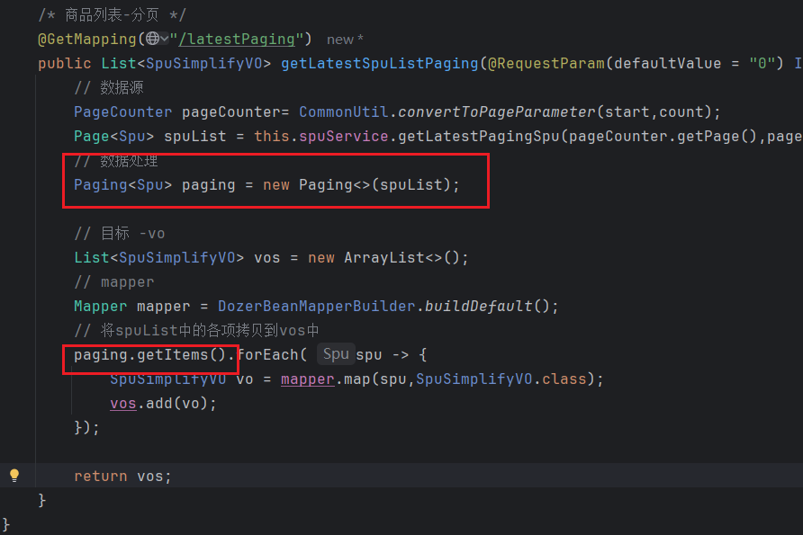

# JPA 的多种查询

# spu 列表接口：（具有代表性） /latest
- 列表的数据如何将一组数据赋给vo呢？安装依赖 dozermapper 处理List的属性拷贝
- dozermapper优势：可以进行深拷贝（如果下面有数组）

## 处理List的属性拷贝
```xml
<dependency>
    <groupId>com.github.dozermapper</groupId>
    <artifactId>dozer-core</artifactId>
    <version>6.5.0</version>
</dependency>
```
`接口处理：`
```java
@GetMapping("/latest")
  public List<SpuSimplifyVO> getLatestSpuList(){
      // 数据源
      List<Spu> spuList = this.spuService.getLatestPagingSpu();
      // 目标 -vo
      List<SpuSimplifyVO> vos = new ArrayList<>();
      // mapper
      Mapper mapper = DozerBeanMapperBuilder.buildDefault();
      // 将spuList中的各项拷贝到vos中
      spuList.forEach( spu -> {
          SpuSimplifyVO vo = mapper.map(spu,SpuSimplifyVO.class);
          vos.add(vo);
      });

      return vos;
  }
```
> 接口返回数据：
```json
[
    {
        "id": 2,
        "title": "针织衫",
        "subtitle": "秋日红框，浪漫满屋",
        "price": "77.00",
        "sketch_spec_id": 1,
        "default_sku_id": 2,
        "img": "xxx",
        "discount_price": "62",
        "description": null,
        "tags": "秋日冬款$浪漫满屋"
    }
]
```


## 分页
- 分页参数：pc端Page，size，移动端start，count；且参数非必须，需要有默认值


### BO（businsess） 业务对象，service向controller传输对象
- 前端传入的是start和count ，需要转换为 pageNum和size；即service向controller传start，需要经过BO处理为pageNum
- 新建bo包，创建PageCount类
- 封装方法

### VO 创建返回给前端的分页类（Paging）
- 封装Paging
```java
// 这里传入泛型，因为Paging是公共的封装，可能是Page<Spu> Page<Sku>
@Getter
@Setter
public class Paging<T> {
    // 分页数据基本结构
    private Integer page; // 当前页码
    private Integer count; // 条数
    private Integer totalPage;// 总页数
    private Long total; //总条数
    // 列表数据
    List<T> items;

    //返回给前端的数据处理
    public Paging(Page<T> pageT) {
        this.initPageParameters(pageT);
        this.items = pageT.getContent();
    }

    // 获取分页数据
    void initPageParameters(Page<T> pageT) {
        // 以下方法都是Page对象内置的方法
        this.page = pageT.getNumber();
        this.count = pageT.getSize();
        this.totalPage = pageT.getTotalPages();
        this.total = pageT.getTotalElements();
    }
}
```

- 使用的地方

此时的分页数据：
```json
[
    {
        "id": 2,
        "title": "针织衫",
        "subtitle": "秋日红框，浪漫满屋",
        "price": "77.00",
        "sketch_spec_id": 1,
        "default_sku_id": 2,
        "img": "xxx",
        "discount_price": "62",
        "description": null,
        "tags": "秋日冬款$浪漫满屋"
    },
    {
        "id": 3,
        "title": "t恤",
        "subtitle": "哈哈哈",
        "price": "57.00",
        "sketch_spec_id": 1,
        "default_sku_id": 2,
        "img": "xxx",
        "discount_price": "62",
        "description": null,
        "tags": "秋日冬款$浪漫满屋"
    }
]
```

> 问题：需要循环paging.getItems()，如何封装这里-抽一个VO PagingDozer继承Paging做属性的复制
```java
/* 如果不需要精简属性用Paging对象即可，如果需要精简属性需要使用PagingDozer */
/* T -代表源，K代表目标 */
public class PagingDozer<T,K> extends Paging {

//    @SuppressWarnings("unchecked") // 忽略警告
    public PagingDozer(Page<T> pageT,Class<K> classK) {
        // 调用Paging的基本属性赋值
        this.initPageParameters(pageT);
        // items属性复制 - Mapper
        List<T> items = pageT.getContent();
        // vo
        List<K> vos = new ArrayList<>();
        // mapper
        Mapper mapper = DozerBeanMapperBuilder.buildDefault();
        // 将spuList中的各项拷贝到vos中
        items.forEach( t -> {
            // 目标源类不能直接K.class，通过构造函数传
            K vo = mapper.map(t,classK);
            vos.add(vo);
        });
        // 需要将数据set进去
        this.setItems(vos);
    }
}
```


# 分类表的设计 - 一张表
- index排序，is_root是否根节点，online是否下架，level几级分类（如果分类层级较多，level可以简化查询）


## 目前方式
节点，记住父级节点的id
> 缺点：不好回溯。即一个5级节点，知道第五级节点，需要一层层向上找才能找到一级节点


## 改进：路径表示法
- 记录分类的完整路径，新增一个path字段存完整的分类路径（牺牲了一定的数据库存储空间，但是可以提高查询效率）
- 两级分类推荐用第一种，如果分类层级较多或者无限级推荐路径表示法更好。


## 写api - 根据分类id查spu，/by/category/{id}
- 根据一级分类查spu列表
- 或者 根据二级分类查spu列表

1. 导入分类表
2. 使用JPA带条件查询（命名方式推导出的SQL语句）
3. 校验返回Message的处理。(可以截取前面不要的，不要返回给前端。)


#` 规格
