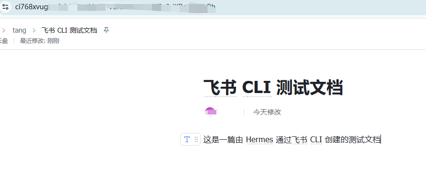
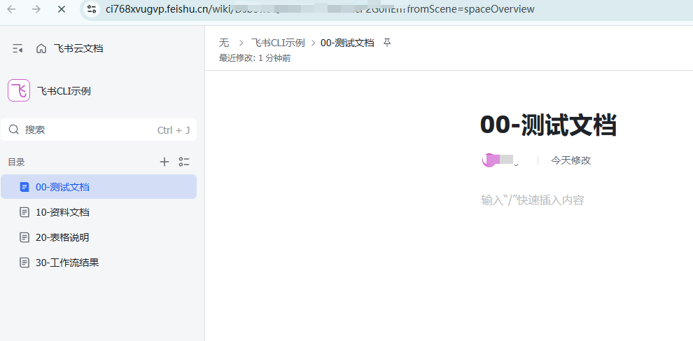
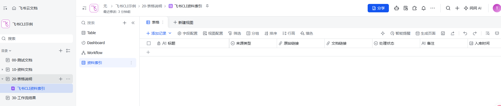
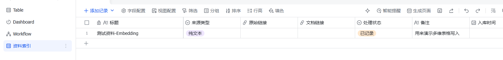

# hermes调用飞书CLI

## 安装飞书CLI - lark-cli
> 它内置了面向 Agent 的使用提示。比如文档、多维表格、知识库这些能力，CLI 会提醒 Agent 先读取对应的内置 Skill，再选择具体命令。也就是说，Agent 时代的新式 CLI 不只是命令列表，还会附带“这些命令应该怎么用”的说明。
`lark-cli --version`
`测试命令：lark-cli whoami`

## 飞书 CLI 使用-让 Hermes 完成一次最小操作
- step1:准备飞书账号
- step2:让 Hermes 检查当前环境，授权
```text
我已经有飞书账号，也可以在浏览器里完成登录和授权。请你检查本机飞书 CLI 的配置状态。如果还没有完成授权，请指导我完成授权；如果已经可用，请告诉我当前执行身份。
```
- 让 Hermes 创建一篇测试文档
> 帮我创建一篇飞书测试文档，标题是“飞书 CLI 测试文档”，正文是“这是一篇由 Hermes 通过飞书 CLI 创建的测试文档”。创建完成后，请把文档链接告诉我。



## 基本骨架
- 后面无论创建多维表格，还是做真正的飞书应用，底层都是这套模式。
```text
用户提出目标
  ↓
Hermes 检查账号、授权和权限
  ↓
Hermes 读取命令说明和 Skill
  ↓
Hermes 执行写入
  ↓
Hermes 给用户回执
```


# 创建一个飞书知识库：让文档有稳定位置
- 之前创建的测试文档不在知识库下

## 创建飞书知识库
```text
请你帮我创建一个新的飞书知识库，名称叫“飞书CLI示例”。
这个知识库后面用来保存本章示例里创建的测试文档、资料文档、表格说明。

创建完成后，请把知识库名称和可以打开的链接返回给我。
```

## 创建基础目录
```text
请你在“飞书CLI示例”这个知识库下面创建四个目录：

00-测试文档
10-资料文档
20-表格说明
30-工作流结果

创建完成后，请返回每个目录的名称和链接。
```



## 添加文档到指定目录下
```text
请你把下面这段文字创建成一篇飞书资料文档，放到“飞书CLI示例 / 10-资料文档”目录下面。标题叫“测试资料-Embedding”。

Embedding 会把文本变成一组数字向量。向量之间可以计算距离，所以语义相近的文本通常会在向量空间里更接近。
```


> 但只靠文档和知识库还不够。后面一旦资料多起来，用户还需要知道每份资料的标题、来源、文档链接和处理状态。

所以下一节要引入多维表格。文档负责保存内容，多维表格负责记录状态。三者合在一起，后面的飞书小工作流才有基础。


# 创建多维表格：记录资料和处理状态
> 但只靠文档和知识库还不够。后面一旦资料多起来，用户还需要知道每份资料的标题、来源、文档链接和处理状态。
所以要引入多维表格。文档负责保存内容，多维表格负责记录状态。三者合在一起，后面的飞书小工作流才有基础。

## 多维表格是什么？
- 飞书多维表格更像一张可以不断补充信息的在线数据表。每一行是一条记录，每一列是这条记录的一个属性。字段不只有文字和数字，还可以是单选状态、成员、日期、链接、附件，甚至能关联到另一张表。
某种意义上，可以把它看作一个在线的关系型数据库表，比如 MySQL、PostgreSQL 里的数据表。
承担资料账本

## 创建一个多维表格
- 飞书的多维表格是一个独立资源，**不是挂在知识库下面的文档**。你可以把它理解成飞书里的一个专门表格应用，里面再放一张或多张表

### 创建
```text
请你在飞书里创建一个新的多维表格资源，名称叫“飞书CLI资料索引”。
这个表格后面用来记录本章案例里创建的资料文档和处理状态。

创建完成后，请把多维表格名称和打开链接返回给我。
```

### 多维表格里创建资料索引表
```text
请你在“飞书CLI资料索引”这个多维表格里创建一张“资料索引”表。

请按下面的字段创建：

- 标题：文本
- 来源类型：单选，可选 URL、PDF、音频、图片、纯文本
- 原始链接：链接或文本
- 文档链接：链接或文本
- 处理状态：单选，可选 待处理、已记录、已整理、不再使用
- 备注：文本
- 入库时间：日期时间

创建完成后，请返回表名和打开链接。
```



### 表格内写测试记录
```text
请你在“资料索引”表里写入一条测试记录：

- 标题：测试资料-Embedding
- 来源类型：纯文本
- 处理状态：已记录
- 备注：用来演示多维表格写入

写入完成后，请返回这条记录所在的表格链接和记录 ID。
```
